<!--
         .--.
        |o_o |     Hola, curioso del código fuente 👀
        |:_/ |     Si llegaste hasta aquí, ya eres de los míos.
       //   \ \    Pista: no todos los comandos de abajo están solo de adorno.
      (|     | )
     /'\_   _/`\
     \___)=(___/
-->

<div align="center">



</div>

## `$ whoami`

Estudiante de **Análisis y Desarrollo de Software (ADSO)** en Yopal, Colombia.
Construyo soluciones reales: plataformas web, sistemas para negocios y modelos de predicción con Machine Learning.

<details>
<summary><code>$ man santiago</code></summary>

```text
SANTIAGO(1)                  User Commands                  SANTIAGO(1)

NAME
       santiago - desarrollador full stack, convierte café en código

SYNOPSIS
       santiago [--build] [--debug] [--learn-something-new]

DESCRIPTION
       Proceso de larga duración. Arranca con café, compila ideas y
       rara vez entra en modo sleep.

OPTIONS
       --build     Convierte un problema real en una app que funciona.
       --debug     Encuentra el bug. Eventualmente.
       --deploy    Solo los viernes si se siente valiente.

BUGS
       Ninguno conocido. Los desconocidos son features.

SEE ALSO
       react(1), django(1), coffee(6)
```

</details>

## `$ cat stack.txt`

| | |
|---|---|
| **Languages** |     |
| **Backend** |    |
| **Frontend** |   |
| **Data / ML** |    |

## `$ ls -l projects/`

| | Proyecto | De qué trata | Stack |
|---|---|---|---|
| `drwxr-xr-x` | **[jobsy/](https://github.com/SantiagoRicaurte06/Jobsy_Front)** | Marketplace que conecta hogares con trabajadores del hogar. Front, capa media y API en microservicios. · [api](https://github.com/SantiagoRicaurte06/Jobsy_API) · [mid](https://github.com/SantiagoRicaurte06/Jobsy_Mid) | Angular · Go · PostgreSQL |
| `drwxr-xr-x` | **[yopvial/](https://github.com/juanezzzzz/seguridad-vial)** | Guía interactiva de seguridad vial para Yopal: juegos, reportes ciudadanos (PQR) y mapa de zonas de riesgo. · [demo](https://juanezzzzz.github.io/seguridad-vial/) | HTML · CSS · JS · Leaflet |
| `drwxr-xr-x` | **[rrhh-api/](https://github.com/SantiagoRicaurte06/Gestion_Recursos_Humanos_API_DJango)** | API de recursos humanos: empleados, nómina, contratos y vacaciones, con auditoría y exportación a CSV/Excel. | Django REST · PostgreSQL · JWT |
| `drwx------` | **nba-predictor-pro/** 🔒 | Predicción de partidos NBA con backtesting walk-forward. *Próximamente público.* | XGBoost · Poisson · Streamlit |
| `drwx------` | **zona-gamer-turnos/** 🔒 | Sistema a la medida para una sala gamer: cierre de caja por turnos, nómina e inventario, con soporte offline. | React · TypeScript · Supabase |

<details>
<summary><code>$ cat .secrets</code></summary>

```text
cat: .secrets: Permission denied

...bueno, solo uno:
el 90 % de mis bugs se arreglan explicándoselos a alguien,
el otro 10 % se arregla al día siguiente sin haber cambiado nada. 🐛
```

</details>

## `$ git log --graph`

<div align="center">

<picture>
  <source media="(prefers-color-scheme: dark)" srcset="https://raw.githubusercontent.com/SantiagoRicaurte06/SantiagoRicaurte06/output/pacman-contribution-graph-dark.svg">
  <source media="(prefers-color-scheme: light)" srcset="https://raw.githubusercontent.com/SantiagoRicaurte06/SantiagoRicaurte06/output/pacman-contribution-graph.svg">
  
</picture>

[](https://git.io/streak-stats)

</div>

## `$ cat contact`

<!-- Pon tus enlaces dentro de los paréntesis vacíos -->
[](mailto:santiagoricuarte@gmail.com)
[]()
[]()
[]()

<details>
<summary><code>$ sudo rm -rf /</code></summary>

```text
[sudo] password for visitor: ********
visitor is not in the sudoers file. This incident will be reported. 😏
```

</details>

<details>
<summary><code>$ exit</code></summary>

```text
logout
...
You can check out any time you like, but you can never leave. 🎸
```

</details>

---

<div align="center">


</div>

<!-- sudo pacman -Syu && echo "gracias por leer hasta el final" -->
